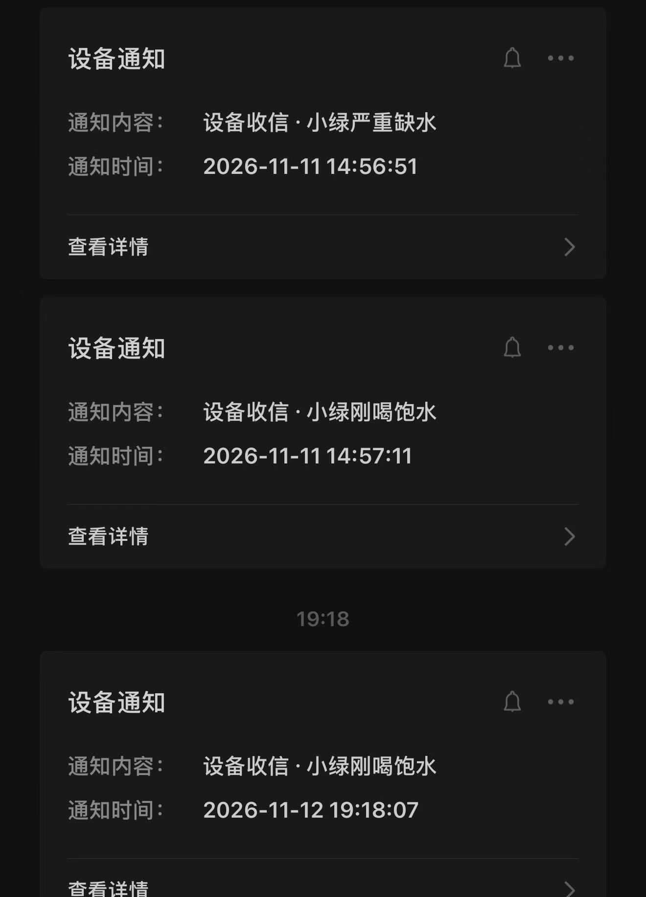
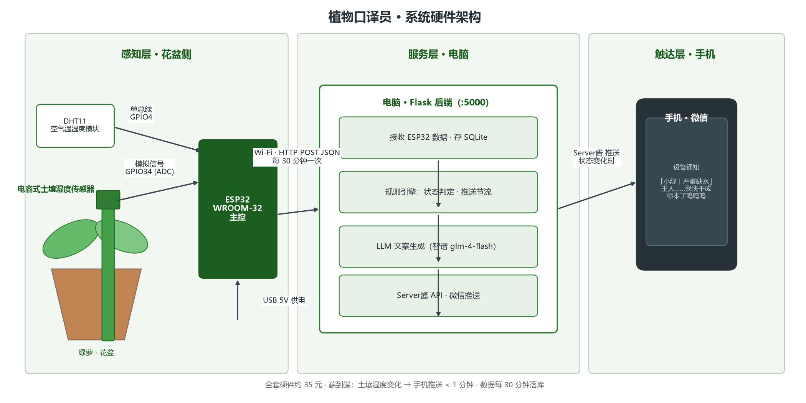
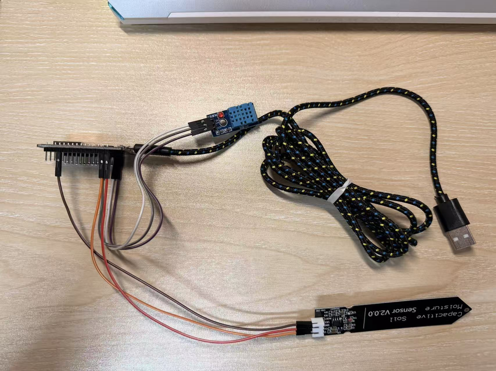

# 植物口译员 🌱

土壤传感器 + ESP32 + LLM：让植物用第一人称给你发微信。

> 过去我们教机器「看哪里」；这个项目让一盆绿萝学会「发朋友圈」——  
> 「主人，我已经三天没喝水了，你是不是忘了我……」

## 效果



植物按真实土壤湿度用第一人称发来"设备通知"——快渴了会喊你，喝饱了会道谢，状态正常时保持沉默。

（待补：7 天土壤湿度曲线图）

## 架构



```
[花盆土壤] → ESP32(Wi-Fi, 30min/次) → Flask 后端 → SQLite
                                          ↓
手机微信 ← Server酱推送 ← LLM 文案生成 ← 规则引擎(状态判定/节流)
```

设计原则：**确定性代码负责状态判定与节流，LLM 只负责把数据翻译成人话**——  
LLM 故障时自动降级为固定格式文案，通知功能永不失效。

## 硬件清单

- ESP32-WROOM-32 开发板（CP2102）
- 电容式土壤湿度传感器 v2.0.0
- DHT11 温湿度模块
- 杜邦线（母对母）

## 接线

| 传感器引脚                  | ESP32 引脚           |
| ---------------------- | ------------------ |
| 土壤传感器 UCC              | VIN (5V)           |
| 土壤传感器 GND              | GND                |
| 土壤传感器 AOUT             | GPIO 34            |
| DHT11 VCC / GND / DATA | 3V3 / GND / GPIO 4 |

> 每只传感器的干湿读数不同，更换传感器需重新标定（悬空记 `CALIB_DRY`，  
> 泡水记 `CALIB_WET`，填入 `plant_interpreter.ino` 顶部）。



## 快速开始

1. 安装 Arduino IDE + ESP32 板卡包 + CP2102 驱动，烧录 `code/esp32/plant_interpreter.ino`  
   （填入 Wi-Fi 名密码与后端地址）
2. 后端：
   ```bash
   pip install -r requirements.txt
   python app.py   # 在 app.py 中填入自己的 SendKey 与 API Key
   ```
3. 注册 [Server酱](https://sct.ftqq.com/)（推微信）与  
   [智谱开放平台](https://open.bigmodel.cn/)（LLM，glm-4-flash 免费）

## 智能逻辑

- **状态机**：湿度 <30% 严重缺水 / <55% 有点渴 / >85% 刚喝饱 / 其余状态良好
- **节流**：状态变化才推送；严重缺水每 6 小时催一次；每日上限 5 条
- **叙事**：LLM 以植物第一人称生成朋友圈文案，输入是湿度/断水天数等真实数据
- **降级**：LLM 调用失败时使用固定格式文案，推送链路不中断

## 已知限制

- 后端需运行在常开的电脑上；夜间宿舍断电时段无数据（曲线出现规律缺口）
- 电容式传感器读数受表面残留水分与温度影响，±5% 内漂移属正常

## 致谢

- [Adafruit DHT sensor library](https://github.com/adafruit/DHT-sensor-library)
- [Server酱](https://sct.ftqq.com/) · [智谱开放平台](https://open.bigmodel.cn/)

## License

[MIT](LICENSE)
